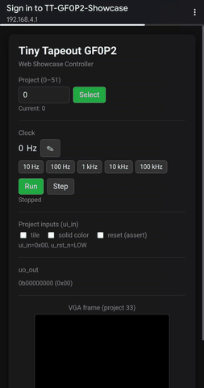

# Tiny Tapeout GF0P2 Web Showcase Firmware

## What

ESP32 based web interface to the Tiny Tapeout TTGF0P2 business card chip.

## Why

I volunteered to be a TA at a Tiny Tapeout workshop at Hackaday Supercon 2026.
As part of that, all attendees were given a Tiny Tapeout chip on a business
card sized PCB. Typically, Tiny Tapeout chips are mounted on devkits to be used
with PMODs. Since I don't have any PMODs and even if I did I would have to solder
a connector to this board, I wondered how else I could test it.

Since all inputs and outputs are digital, it seemed like a natural next step to
read and write to those pins with a microcontroller. In fact, the guide instructs
you to use a microcontroller to set the project, so why stop there? I enjoy the
flexibility and accessibility that the Wokwi simulator brings, so my goal is to
replicate that in functionality as close as possible, with some extras.

**Tiny Tapeout provided documentation:** https://tinytapeout.com/guides/get-started-had-gf0p2/

## Features

- Select any TTGF0P2 project (0–51) from a web page.
- Adjustable project clock: run, stop, set frequency, single-step.
- Live display of `uo_out[0..7]` as LEDs.
- No app required. Captive portal opens the web UI automatically when you connect to the AP.
- **(Slow) VGA frame capture for project 33 (Wafer.space screensaver) with row-by-row streaming.**

## AI Usage

This project uses AI heavily. I've been experimenting with the open weight models through
API access recently like Kimi K2.7 Code and GLM-5.3-Flash. I've found great success in
giving the AI access to the USB port of the ESP32 so it can flash and test over serial.

## Documentation

| Topic | Document |
|---|---|
| Hardware wiring and pinout | [`docs/WIRING.md`](docs/WIRING.md) |
| Flash a pre-built release binary | [`docs/FLASHING.md`](docs/FLASHING.md) |
| Build and flash from source | [`docs/DEVELOPER.md`](docs/DEVELOPER.md) |
| Using the web UI | [`docs/USAGE.md`](docs/USAGE.md) |
| Serial debug commands | [`docs/SERIAL.md`](docs/SERIAL.md) |
